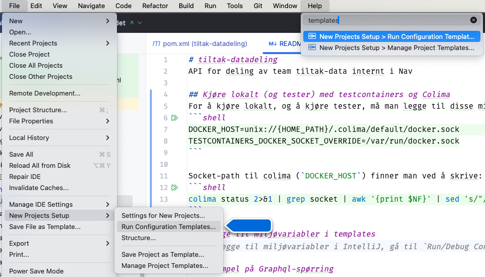

# tiltak-datadeling

Deler data om arbeidsmarkedstiltak internt i Nav via BigQuery.

Appen leser avtaler fra Kafka-topicet `arbeidsgiver.tiltak-avtale-hendelse-compact` og lagrer siste versjon av
hver avtale i Postgres. Datastream speiler databasen til BigQuery, der dataene blant annet brukes i Metabase.

Appen hadde tidligere et GraphQL-API. Det er fjernet, se [ADR 04](docs/adr/04_fjerne_api.md).

Les [bruksvilkårene](docs/bruksvilkaar.md) før du tar i bruk dataene. Still spørsmål i #arbeidsgiver-tiltak på Slack.

## Kjøre lokalt (og tester) med testcontainers og Colima

For å kjøre lokalt, og å kjøre tester, må man legge til disse miljøvariablene:

```shell
DOCKER_HOST=unix://{HOME_PATH}/.colima/default/docker.sock
TESTCONTAINERS_DOCKER_SOCKET_OVERRIDE=/var/run/docker.sock
```

Socket-path til colima (`DOCKER_HOST`) finner man ved å skrive:

```shell
colima status 2>&1 | grep socket | awk '{print $NF}' | sed 's/"//'
```

### Legge til miljøvariabler i templates

For å legge til miljøvariabler i IntelliJ, gå til `Run/Debug Configurations` -> `Templates` -> `JUnit`/`Spring Boot`/
`Kotlin` -> `Environment variables` og legg til variablene der.


# OBS: Når nye kolonner legges til i databasen

Når man legger til nye felter i datadeling (sjekk feks
migreringen [V07__nye_felter.sql](src/main/resources/db/migration/V07__nye_felter.sql)),
må man også sørge for at feltene blir tilgjengelig i Metabase. Datadeling har en datastrøm mellom cloudsql og bigquery,
men i tillegg har Metabase et eget "view" på BigQuery-tabellen, som ikke oppdateres automatisk.

Her er malen for spørringen man må kjøre i BigQuery for å oppdatere viewet:

```sql
CREATE
OR REPLACE VIEW `<VIEW_NAVN>` AS
<QUERY-DEFINISJON-TIL-VIEWET>;
```

Navnet på viewet finner man i Google Cloud-konsollen (BigQuery -> Studio -> _Finn datasettet_ -> _Finn tabellen_ ->
View details -> View name).
Query-definisjonen finner man også i Details-visningen under "Query".
